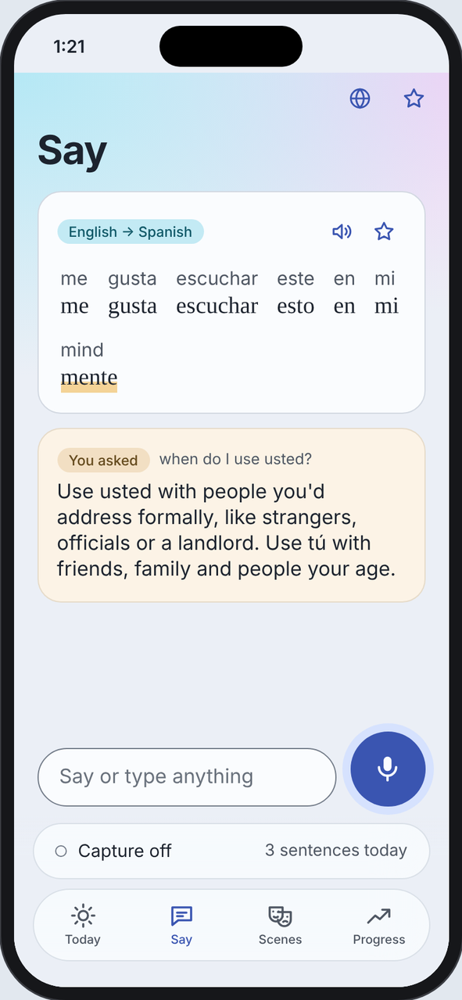
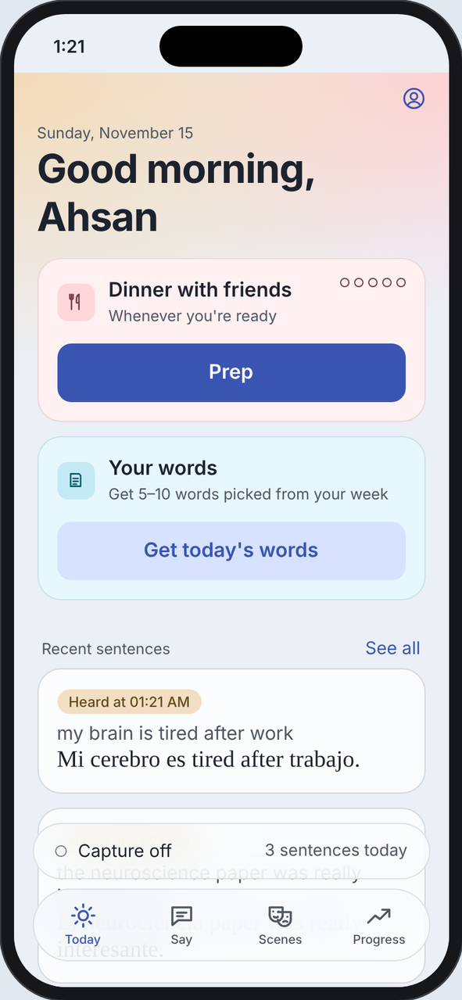
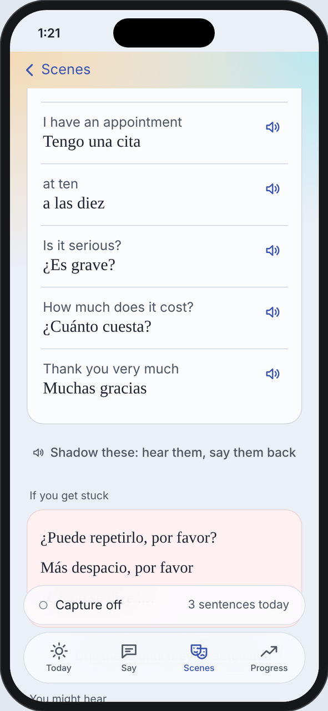
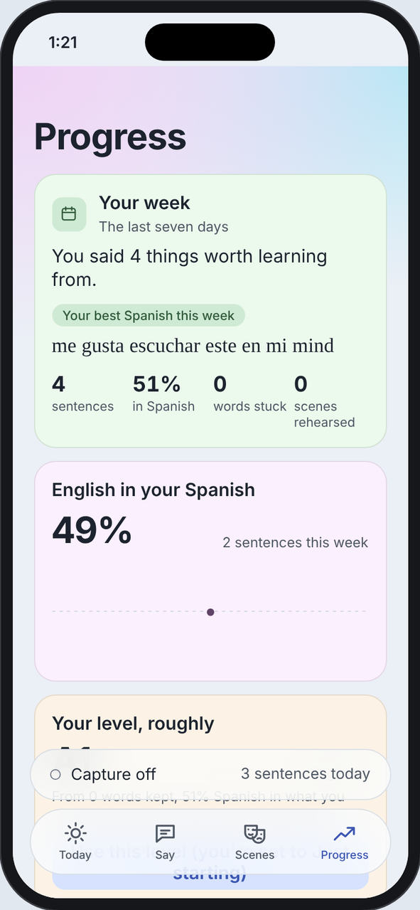
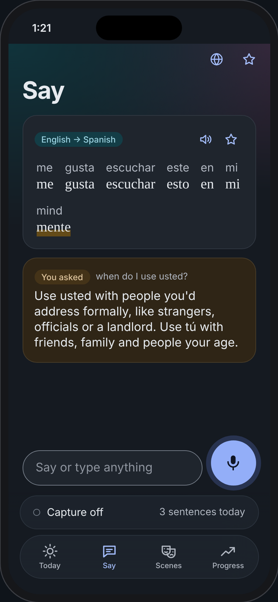

# Intuye

[](https://github.com/AiKoushik/intuye/actions/workflows/ci.yml)
[](LICENSE)

**Sense it. Say it.**

Intuye is a language coach for iPhone that starts from how you actually talk. Say something in English, or in a mix of English and the language you're learning, and it comes back in that language as close to your own words as grammar allows, so you can see which word became which. It gets you ready for the situations coming up in your life, not a fixed curriculum, and it picks 5 to 10 words a day from what you said.

Spanish is the first language. Everything specific to a language lives in a language pack, so more can be added without touching the app. *Intuye* (in-TOO-yeh) is Spanish for "senses it".

<p align="center">
  
  
  
  
  
</p>

## What it does

| | |
|---|---|
| **Say it your way** | Type or speak English, the target language, or a mix of both. You get one short line back, aligned word by word, with new words marked. Questions about the language get an answer of three sentences at most. |
| **Scenes** | Tell it what's coming up (the dentist on Thursday, a parent teacher meeting) or let it find events in your calendar. It prepares the phrases you'll want to say, the ones you'll hear, and rescue phrases for when you get stuck. |
| **Shared scene library** | Scenes you create are shared with other learners, anonymously unless you choose otherwise, when nothing similar exists yet. The library is searchable by meaning, by text or by voice. |
| **Rehearse** | Role play the scene with a partner who answers in the target language. Answer in English when you're stuck and get it back in the target language. |
| **Words that matter to you** | Every day, 5 to 10 words picked from what you said and what's coming up, each with the reason it was picked, scheduled with FSRS. |
| **Pronunciation** | Drills and shadowing scored sound by sound, with one tip for the sound you missed. |
| **Grammar on demand** | When your own sentences need a pattern, a 60 second lesson with three examples and one check. |
| **Capture** | Optional listening during windows you choose. Audio stays on the phone and only text is sent. Pause any time, forget the last 10 minutes, or delete any sentence. |
| **Progress** | A calm weekly reflection, how much English is left in your target language week by week, confidence by scene, and a rough level you can adopt. No streaks. |
| **Reminders** | At most a few a day, never in quiet hours or within an hour of each other, and each one says why it's there. |
| **Siri and Shortcuts** | Ask "How do I say something in Intuye" and hear the answer without opening the app. |

## How it's built

| Part | Stack |
|---|---|
| iPhone app | SwiftUI for iOS 26, an `IntuyeKit` Swift package (models, API client, offline queues), App Intents. Speech is recognised on the device. |
| Backend | Python 3.11+, FastAPI, SQLAlchemy (SQLite for development, Postgres for real use). Every model call runs through a [LangChain Deep Agents](https://github.com/langchain-ai/deepagents) agent on LangGraph. |
| Web test build | A browser copy of the iPhone screens, served by the backend in development, for trying everything without a Mac. |
| Design | An OKLCH colour system generated into Swift, CSS and an asset catalog, with every text and background pair checked for contrast. |

The agents are a translator, an explainer, an ingest analyst for captured sentences, a scene builder that searches the shared library and delegates to a phrase writer, a rehearsal partner and a summariser. They work with any model that supports tool calling, local or hosted. Security covers Sign in with Apple, rotating sessions, App Attest on every call, rate limits, and prompts that treat learner text as data. The details are in [`docs/`](docs/).

## Status

| Part | State |
|---|---|
| Backend | Built. The tests pass (`pytest`) and run in CI on every pull request. |
| Web test build | Complete for testing. An end to end browser test (`scripts/e2e.sh`) covers every screen and runs in CI. |
| iPhone app | All screens written. Not compiled yet, so expect a round of build fixes on the first build in Xcode. |

The feature by feature status is in [`docs/02-feature-list.md`](docs/02-feature-list.md).

## Try it

You need [conda](https://docs.conda.io/en/latest/miniconda.html). One command creates the `intuye` environment on the first run, installs dependencies, writes `backend/.env` from `backend/.env.development`, starts the API and opens the web test build.

```powershell
# Windows (PowerShell, or double click scripts\run-backend.bat)
.\scripts\run-backend.ps1                    # http://localhost:8000/web/   API docs at /docs
.\scripts\run-backend.ps1 -Model local       # your own model server, from backend\.env
.\scripts\run-backend.ps1 -Model anthropic   # Claude, with ANTHROPIC_API_KEY in backend\.env
.\scripts\run-backend.ps1 -Test              # run the tests first
.\scripts\run-backend.ps1 -BindHost 0.0.0.0  # reachable from an iPhone on the same Wi-Fi
```

```bash
# macOS, Linux, WSL
scripts/run-backend.sh [--model local|anthropic|fake] [--test] [--update] [--host 0.0.0.0] [--port 8000]
```

Out of the box the backend uses `LLM_PROVIDER=fake`, a tiny offline model that knows a few Spanish phrases, so you can click through every screen without a model server. The web build signs you in with just a name, and speech works in Chrome and Edge. Open a private window and sign in with another name to see shared scenes from a second learner's side.

Without the scripts

```bash
conda env create -f backend/environment.yml && conda activate intuye
cd backend && pip install -e ".[dev]" && cp .env.development .env
pytest
uvicorn app.main:app --reload
```

### Models

| `LLM_PROVIDER` | What it uses |
|---|---|
| `openai_compatible` | Any OpenAI style endpoint (Ollama, vLLM, llama.cpp, your own server) through `LLM_BASE_URL`, `LLM_FAST_MODEL` and `LLM_SMART_MODEL` |
| `anthropic` | Claude, with `ANTHROPIC_API_KEY` |
| `fake` | The offline test model |

The model needs tool calling, since the agents use tools for structured output and subagents. Scene library search uses `EMBED_PROVIDER`, either `hash` (offline) or `openai_compatible` with an embedding model such as `bge-m3`.

## Build the iPhone app

You need a Mac with Xcode 26 or later.

```bash
brew install xcodegen
cd ios && xcodegen generate && open Intuye.xcodeproj
```

1. Set your Team ID in `ios/project.yml` (`DEVELOPMENT_TEAM`) and a real bundle id, and set `APPLE_TEAM_ID` and `APPLE_BUNDLE_ID` in `backend/.env` to match.
2. Turn on Sign in with Apple and App Attest for the App ID in the Apple Developer portal.
3. The Simulator can't attest, so run the backend with `APP_ATTEST_MODE=report` or `off`. On a device, point `LC_API_BASE_URL` in `project.yml` at your computer's address on the network, for example `http://192.168.1.20:8000`, and switch to `enforce` once the first registration succeeds.

## Languages

`LANGUAGES=es` in `backend/.env` lists the languages offered. A language pack holds the grammar triggers and lessons, pronunciation rules, starter vocabulary, regional varieties with their voices and speech locales, prompt examples, and the copy the apps show. The apps read all of it from `GET /v1/languages` and never name a language themselves. Adding one is a new folder under `backend/app/languages/` plus one line in the registry, as described in [`docs/11-languages.md`](docs/11-languages.md).

## Repository

| Path | What's in it |
|---|---|
| [`backend/`](backend/) | API, agents, language packs, curation, tests |
| [`web/`](web/) | The web test build |
| [`ios/`](ios/) | XcodeGen project, `IntuyeKit` package and the SwiftUI app |
| [`design/`](design/) | Colour source, token generator and the clickable prototype |
| [`docs/`](docs/) | Vision, features, UX, design system, architecture, security, data model, API, curation, roadmap, languages |
| [`scripts/`](scripts/) | Run scripts for Windows, macOS and Linux, the end to end test runner and the GitHub setup script |
| [`.github/`](.github/) | CI, Dependabot, branch rulesets, code owners, and pull request and issue templates |

Design tokens are rebuilt with `python design/tokens/generate.py --check`, which fails if any colour pair misses its contrast target.

## Contributing

Issues and pull requests are welcome. Please read [CONTRIBUTING.md](CONTRIBUTING.md) first.

| Branch | Role |
|---|---|
| `main` | Released code. Changes arrive only from `release/*` and `hotfix/*` pull requests. |
| `develop` | Where work lands. Open your pull request here. |
| `feature/*`, `fix/*`, `docs/*`, `chore/*` | Your branch, made from `develop` |

Both `main` and `develop` are protected. Every change goes through a pull request, CI has to pass (backend tests, web build and design tokens, plus the end to end test for `main`), review conversations have to be resolved, and force pushes are blocked. Pull requests into `develop` are squash merged, so the pull request title becomes the commit message and follows [Conventional Commits](https://www.conventionalcommits.org/). How the repository is configured is in [`docs/12-repository.md`](docs/12-repository.md).

Found a security problem? Please report it privately as described in [SECURITY.md](SECURITY.md), not in an issue.

Contributions are welcome under the [Contributor Licence Agreement](CLA.md), which you sign once on your first pull request.

## Licence

Intuye is free software under the [GNU Affero General Public License v3.0 or later](LICENSE). If you run a modified version of the backend for other people over a network, the licence asks you to offer them its source. The apps link to the source from Settings, and the API serves the link at `GET /about`.

The maintainer can also offer Intuye under other terms, such as a commercial licence or a paid edition, which is why contributors sign the [Contributor Licence Agreement](CLA.md). The name and logo are not part of the licence. See [TRADEMARKS.md](TRADEMARKS.md).

Copyright © 2026 Ahsan Iqbal.
