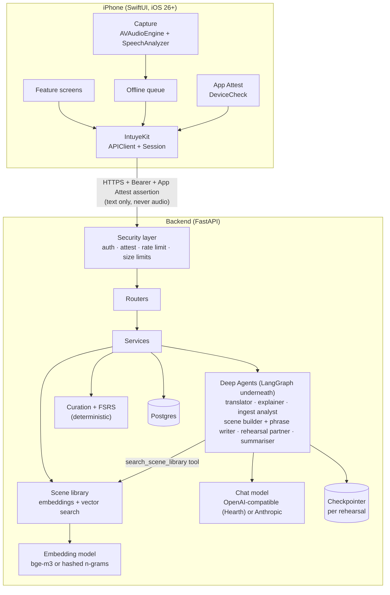

# Architecture



Audio is captured and transcribed on the phone; only text crosses the network. Every request passes
the security layer: a short-lived bearer token proves *who*, an App Attest assertion proves *which
app*. Services own business rules; LangChain Deep Agents make every model call; routing, brevity, pack
validation, library de-duplication, curation and spaced repetition are plain deterministic Python so
they are cheap, testable and explainable.

## iOS app

| Layer | Contents |
|---|---|
| `Intuye` (app target) | `App/` entry + tab scaffold · `DesignSystem/` tokens, typography, components · `Features/` one folder per tab/flow · `Services/` platform integrations |
| `Services/` | `CaptureService` (AVAudioEngine → `SpeechAnalyzer`/`SpeechTranscriber`, on-device), `AuthService` (Sign in with Apple), `AttestService` (`DCAppAttestService`), `KeychainStore`, `CalendarService` (EventKit, opt-in), `NotificationScheduler`, `Haptics` |
| `IntuyeKit` (Swift package) | `Models` (Codable DTOs mirroring the API) · `APIClient` (async/await, single-flight token refresh, assertion signing hook) · `TokenStore` protocol · `OfflineQueue` |

- **State:** `@Observable` view models per feature, injected through the environment from one
  `AppModel`. No third-party dependencies in v1.
- **Project file:** generated by XcodeGen from `ios/project.yml`, so the repo never stores a
  `.xcodeproj` (merge-conflict free).
- **Minimum OS:** iOS 26 (SpeechAnalyzer, Liquid Glass, `tabViewBottomAccessory`). Foundation Models
  on-device translation for short offline sentences is gated behind `#available(iOS 27, *)`.

## Backend

```
backend/app/
  main.py            app factory, middleware, routers
  config.py          settings (pydantic-settings, env-driven)
  db.py              async SQLAlchemy engine/session; Postgres in prod, SQLite in tests
  models.py          ORM tables (see 07-data-model.md)
  security/          tokens.py, apple.py (SIWA), app_attest.py, ratelimit.py, deps.py
  llm/               provider.py (chat-model factory), fake.py (tool-calling test model), prompts.py
  agents/            runtime.py (Deep Agents factory, lean harness, run context)
                     coach.py, ingest.py (deterministic LangGraph pipelines that call agents)
                     scene_builder.py, rehearse.py, schemas.py
  library/           embeddings.py (hash | OpenAI-compatible), index.py (cosine search per variety)
  curation/          fsrs.py, ranker.py, grammar.py, lessons.py, pronunciation.py, text.py (language-neutral)
  languages/         base.py (LanguagePack), es/ (Spanish content), native_en.py; see 11-languages.md
  routers/           auth, attest, coach, utterances, batches, reviews, scenarios, rehearsals, progress, account
```

### Agents (LangChain Deep Agents)

Every model call goes through an agent built with `create_deep_agent` (Deep Agents 0.7, LangGraph
underneath). Each agent has a structured output schema, so nothing free-form reaches the app.

| Agent | Slot | Tools and subagents | Output | Used by |
|---|---|---|---|---|
| **translator** | fast | — | `TranslationOut` | Say (coach pipeline), rehearsal escape hatch |
| **explainer** | smart | — | `AnswerOut` | Say, explicit questions |
| **ingest analyst** | fast | — | `IngestOut` | Capture pipeline (batches of 25) |
| **scene builder** | smart | `search_scene_library` tool; `phrase-writer` subagent via `task` | `SceneCardOut` (generalised library card) | New scenes, calendar scenes |
| **phrase writer** | smart | — | `PrepPackOut` | The scene builder's subagent |
| **rehearsal partner** | smart | — | `CoachTurnOut` | Role-play; checkpointer thread per rehearsal, summarisation middleware for long scenes |
| **summariser** | smart | — | `RehearsalSummaryOut` | End of rehearsal |

**Lean harness.** Deep Agents ships filesystem tools (`ls`, `read_file`, `write_file`, `edit_file`,
`delete`, `glob`, `grep`), a shell tool and a general-purpose subagent. None of our agents touches files
or a shell, so a `HarnessProfile` registered for our models hides those tools and turns the
general-purpose subagent off. What remains is our system prompt (built per call from the run context
by a `dynamic_prompt` middleware: variety, level, scene title, difficulty), our own tools and
subagents, structured output, tool-call patching, summarisation and, on Anthropic, prompt caching. A
translation is still one model call.

**Scene builder.** The main agent searches the library first and, when a close scene exists, tells
the phrase writer to adapt its phrases rather than start fresh. The phrase writer returns the pack as
structured output, which reaches the builder through the `task` tool. The builder then writes the
library card: a general title, one sentence describing the situation, a topic, and `shareable`
(false for anything personal-only, unsafe or identifying). The service takes the pack from the
subagent's result, validates it (8–12 key, 3–5 rescue, 3–6 hear; retry once with the problems), pads
rescue phrases and stores it.

**Rehearsal partner.** One checkpointer thread per rehearsal id holds the conversation. If the
checkpoint is gone (a restart), the router rebuilds the messages from the stored transcript. When the
learner switches to English (≥ 60 % English words), the translator gives the Spanish back before the
partner replies.

**Deterministic wrappers.** The Say tab's `route → translate | answer → brevity_guard` and capture's
`normalise → analyse → extract` stay LangGraph `StateGraph`s whose model steps call the agents above.

**Structured output.** With a raw schema, LangChain picks native structured output where the model
supports it and otherwise offers the schema as a tool. Local models behind an OpenAI-compatible
server therefore need tool calling (for example Qwen3 or Llama 3.1+ on Ollama or vLLM).

### Scene library

| Part | How |
|---|---|
| Embeddings | `EMBED_PROVIDER=openai_compatible` calls `/v1/embeddings` (default `bge-m3`, multilingual, so a Spanglish query finds an English title; BGE M3-Embedding, Chen et al., Feb 2024, arXiv:2402.03216). `hash` is a deterministic hashed word + character n-gram vector for tests and offline dev |
| Index | Cosine similarity over unit vectors in an in-process NumPy matrix per Spanish variety, loaded from the database and reloaded when the row count changes. Comfortable to about 50k scenes per variety; past that, pgvector with an HNSW index (Malkov & Yashunin, Mar 2016, arXiv:1603.09320) |
| De-duplication | The builder's card (`title. situation`) is embedded; if the nearest published scene in the same variety scores ≥ `LIBRARY_SIMILAR_THRESHOLD` (0.82), nothing is published and the learner's scene is linked to it. Cosine over sentence embeddings is the standard semantic-similarity test (Sentence-BERT, Reimers & Gurevych, Aug 2019, arXiv:1908.10084); the threshold depends on the embedding model and should be tuned on real pairs |
| Search | Score = cosine × (1 + 0.05 · ln(1 + uses)), results below 0.3 dropped; an empty query lists the most-used scenes |
| Voice search | On-device speech recognition turns speech into text, which calls the same endpoint. Audio never leaves the phone |

### The brevity contract

Translation and answers follow fixed output schemas enforced by structured output and a final
`brevity_guard` node:

| Intent | Output | Limits |
|---|---|---|
| `to_es` / `to_en` | `close` (one line), `alignment[]`, optional `natural` only if the close version would sound wrong to a native | No explanation field exists in the schema |
| `ask` | `answer` | ≤ 3 sentences, ≤ 320 characters, covers only what was asked |

Router heuristics run before the model: a question *about* language ("what does X mean", "when do I
use…", "how do I say … to my landlord") is `ask`; anything else is a translation. "What does *cómo te
va* mean?" is answered the short way: `"How's it going?"`.

### Model routing

`LLM_PROVIDER` selects the chat model behind every agent:

| Value | Backend | Use |
|---|---|---|
| `openai_compatible` | Any OpenAI-style endpoint (vLLM, llama.cpp, Ollama, Hearth) via `LLM_BASE_URL` | Founder's self-hosted setup |
| `anthropic` | Claude via the Anthropic API | Hosted production |
| `fake` | Deterministic in-process model | Tests and offline dev |

Two model slots: `LLM_FAST_MODEL` (translator, ingest analyst) and `LLM_SMART_MODEL` (everything else).
`EMBED_PROVIDER`, `EMBED_MODEL` and `EMBED_BASE_URL` (empty = `LLM_BASE_URL`) select the embedding model.

## Deployment

- One container image (`uvicorn` workers behind a TLS-terminating proxy), managed Postgres, Redis for
  rate limits once there is more than one instance.
- Self-host option: same container on the founder's machine next to the local model server.
- Migrations: Alembic (P2); v1 creates tables at startup in dev only.
