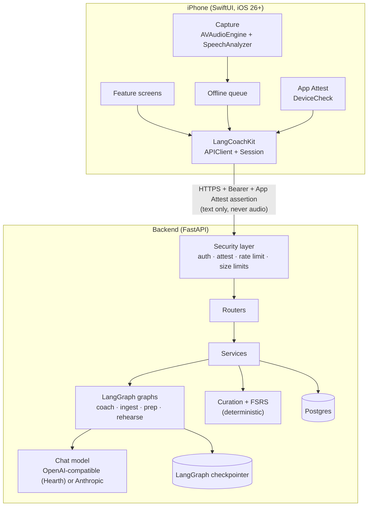

# Architecture



Audio is captured and transcribed on the phone; only text crosses the network. Every request passes
the security layer: a short-lived bearer token proves *who*, an App Attest assertion proves *which
app*. Services own business rules; LangGraph graphs own every multi-step LLM workflow; curation and
spaced repetition are plain deterministic Python so they are cheap, testable and explainable.

## iOS app

| Layer | Contents |
|---|---|
| `LangCoach` (app target) | `App/` entry + tab scaffold · `DesignSystem/` tokens, typography, components · `Features/` one folder per tab/flow · `Services/` platform integrations |
| `Services/` | `CaptureService` (AVAudioEngine → `SpeechAnalyzer`/`SpeechTranscriber`, on-device), `AuthService` (Sign in with Apple), `AttestService` (`DCAppAttestService`), `KeychainStore`, `CalendarService` (EventKit, opt-in), `NotificationScheduler`, `Haptics` |
| `LangCoachKit` (Swift package) | `Models` (Codable DTOs mirroring the API) · `APIClient` (async/await, single-flight token refresh, assertion signing hook) · `TokenStore` protocol · `OfflineQueue` |

- **State:** `@Observable` view models per feature, injected through the environment from one
  `AppModel`. No third-party dependencies in v1.
- **Project file:** generated by XcodeGen from `ios/project.yml`, so the repo never stores a
  `.xcodeproj` (merge-conflict free).
- **Minimum OS:** iOS 26 (SpeechAnalyzer, Liquid Glass, `tabViewBottomAccessory`). Foundation Models
  on-device translation for short offline sentences is gated behind `#available(iOS 27, *)`.

## Backend

```
backend/app/
  main.py            app factory, middleware, routers
  config.py          settings (pydantic-settings, env-driven)
  db.py              async SQLAlchemy engine/session; Postgres in prod, SQLite in tests
  models.py          ORM tables (see 07-data-model.md)
  security/          tokens.py, apple.py (SIWA), app_attest.py, ratelimit.py, deps.py
  llm/               provider.py (chat-model factory), fake.py (deterministic test model), prompts.py
  agents/            coach.py, ingest.py, prep.py, rehearse.py   ← LangGraph StateGraphs
  curation/          fsrs.py, ranker.py, base_lexicon.py, grammar.py, text.py
  routers/           auth, attest, coach, utterances, batches, reviews, scenarios, rehearsals, progress, account
```

### LangGraph graphs

| Graph | Nodes | Why a graph |
|---|---|---|
| **coach** (Say tab) | `route` → `translate` *or* `answer` → `brevity_guard` | One endpoint handles "say it my way" in both directions and explicit questions; the router decides; the guard enforces brevity |
| **ingest** (capture) | `normalise` → `analyse` (batched LLM: Spanish close version + alignment + topic) → `extract_lexemes` → `detect_recurring` | Multi-step pipeline with an optional branch that creates suggested scenarios |
| **prep** (scenarios) | `draft_pack` → `validate` → (retry ≤ 2) → `finalise` | Structured generation with a validation loop |
| **rehearse** (role-play) | `read_user_turn` → (`escape_hatch` \| `correct`) → `coach_reply` → `maybe_end` | Multi-turn, stateful; uses a LangGraph checkpointer keyed by rehearsal id |

### The brevity contract

Translation and answers follow fixed output schemas enforced by structured output and a final
`brevity_guard` node:

| Intent | Output | Limits |
|---|---|---|
| `to_es` / `to_en` | `close` (one line), `alignment[]`, optional `natural` only if the close version would sound wrong to a native | No explanation field exists in the schema |
| `ask` | `answer` | ≤ 3 sentences, ≤ 320 characters, covers only what was asked |

Router heuristics run before the model: a question *about* language ("what does X mean", "when do I
use…", "how do I say … to my landlord") is `ask`; anything else is a translation. "What does *cómo te
va* mean?" is answered the short way: `"How's it going?"`.

### Model routing

`LLM_PROVIDER` selects the chat model behind every graph:

| Value | Backend | Use |
|---|---|---|
| `openai_compatible` | Any OpenAI-style endpoint (vLLM, llama.cpp, Ollama, Hearth) via `LLM_BASE_URL` | Founder's self-hosted setup |
| `anthropic` | Claude via the Anthropic API | Hosted production |
| `fake` | Deterministic in-process model | Tests and offline dev |

Two model slots: `LLM_FAST_MODEL` (coach, ingest) and `LLM_SMART_MODEL` (prep, rehearse).

## Deployment

- One container image (`uvicorn` workers behind a TLS-terminating proxy), managed Postgres, Redis for
  rate limits once there is more than one instance.
- Self-host option: same container on the founder's machine next to the local model server.
- Migrations: Alembic (P2); v1 creates tables at startup in dev only.
