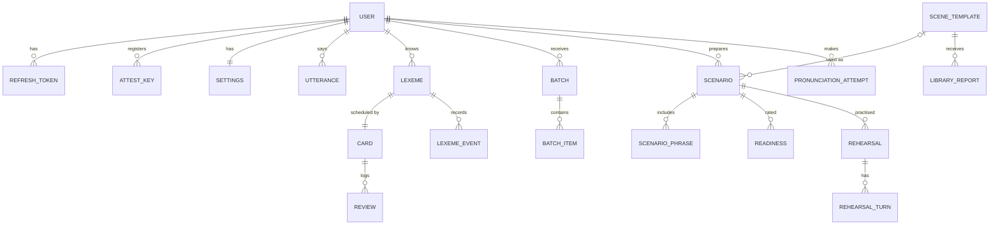

# Data model

All ids are UUIDv4 strings; all timestamps are UTC. Every user-owned table has `user_id` with
`ON DELETE CASCADE`.

Lexemes are the heart of the model: one row per Spanish word or phrase the user has met, wherever it
came from. Cards hold its FSRS state; events record each time it was said, looked up or
mispronounced, which is what the curation ranker reads.

## Tables

| Table | Key columns | Notes |
|---|---|---|
| `users` | `id`, `apple_sub` (unique), `display_name`, `created_at` | No email stored unless the user shares it |
| `settings` | `user_id` (PK), `dialect` (`es-ES`/`es-MX`/`es-419`), `level` (0–5), `daily_notification_budget`, `quiet_start`, `quiet_end`, `moment_retention_days`, `timezone` | One row per user |
| `refresh_tokens` | `id`, `user_id`, `family_id`, `token_hash` (unique), `consumed_at`, `revoked_at`, `expires_at`, `created_at` | Rotation + reuse detection |
| `attest_challenges` | `id`, `challenge` (unique), `expires_at`, `used_at` | Single use |
| `attest_keys` | `key_id` (PK), `user_id` (nullable until sign-in), `public_key_pem`, `counter`, `environment`, `created_at` | One per install |
| `utterances` | `id`, `user_id`, `text`, `lang_mix` (share of English 0–1), `source` (`say`/`ambient`/`rehearsal`), `topic`, `spoken_at`, `close_es`, `created_at` | "Moments" |
| `lexemes` | `id`, `user_id`, `es` (normalised Spanish), `en` (gloss), `origin` (`spoken`/`base`/`scenario`/`grammar`), `topic`, `first_seen_at`, unique(`user_id`,`es`) | |
| `lexeme_events` | `id`, `user_id`, `lexeme_id`, `kind` (`said_en`/`said_es`/`looked_up`/`mispronounced`/`forgot`), `at`, `utterance_id` | Ranker input |
| `cards` | `lexeme_id` (PK), `user_id`, `state` (`new`/`learning`/`review`/`relearning`), `stability`, `difficulty`, `due_at`, `last_review_at`, `reps`, `lapses` | FSRS-4.5 state |
| `reviews` | `id`, `user_id`, `lexeme_id`, `rating` (1–4), `reviewed_at`, `elapsed_days`, `scheduled_days`, `retrievability` | Log for future parameter fitting |
| `batches` | `id`, `user_id`, `created_at`, `completed_at` | |
| `batch_items` | `id`, `batch_id`, `lexeme_id`, `position`, `reason`, `reason_kind`, `score` | Reason shown in UI |
| `scenarios` | `id`, `user_id`, `title`, `details`, `kind` (`upcoming`/`recurring`/`manual`), `starts_at`, `topic`, `status` (`suggested`/`active`/`done`), `template_id` (nullable), `created_at` | `details` is private, never shared |
| `scene_templates` | `id`, `title`, `situation`, `topic`, `dialect`, `level`, `pack` (JSON: key/rescue/hear), `embedding` (JSON floats), `embed_model`, `creator_user_id` (nullable, only when credited), `credit_name` (nullable), `uses`, `reports`, `status` (`published`/`hidden`), `created_at` | The shared library; not user-owned, so it survives account deletion anonymised |
| `library_reports` | `id`, `template_id`, `user_id`, `reason` (`personal`/`offensive`/`wrong`/`other`), `at`, unique(`template_id`,`user_id`) | |
| `scenario_phrases` | `id`, `scenario_id`, `kind` (`key`/`rescue`/`hear`), `en`, `es`, `alignment` (JSON), `position` | |
| `readiness` | `id`, `scenario_id`, `user_id`, `value` (1–5), `phase` (`before`/`after`), `at` | Confidence map |
| `rehearsals` | `id`, `user_id`, `scenario_id`, `difficulty`, `started_at`, `ended_at`, `summary` | LangGraph `thread_id` = `id` |
| `rehearsal_turns` | `id`, `rehearsal_id`, `role` (`coach`/`user`), `text`, `en`, `native`, `at` | |
| `pronunciation_attempts` | `id`, `user_id`, `lexeme_id`, `expected`, `heard`, `score` (0–1), `at` | |

## Static data

- `base_lexicon` (in code, `curation/base_lexicon.py`): high-frequency Spanish core with English
  glosses and a rank, after Davies' frequency list (Davies, *A Frequency Dictionary of Spanish*,
  Routledge, 2006).
- `grammar_triggers` (in code, `curation/grammar.py`): pattern → micro-lesson id.
